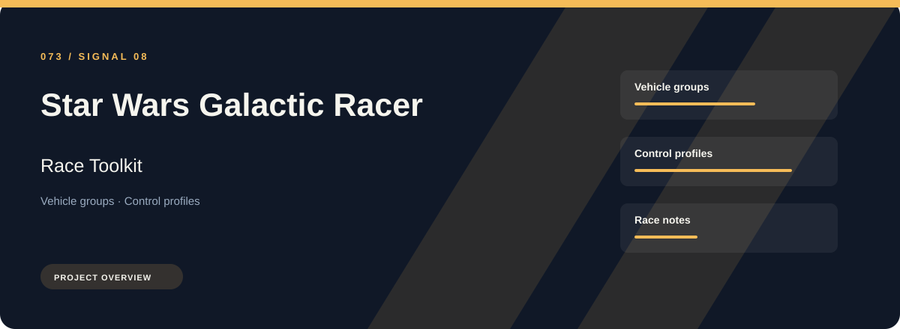
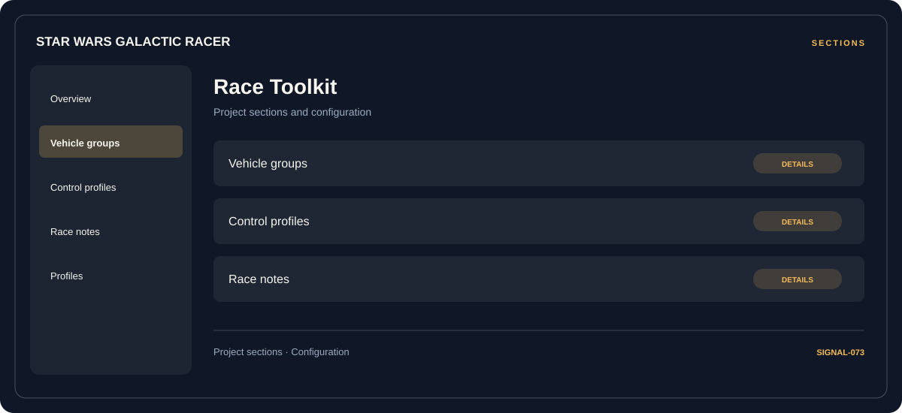

# 🎮 Star Wars Galactic Racer Race Toolkit

**Vehicle groups · Control profiles · Race notes**

## ⚡ Features

Star Wars Galactic Racer Race Toolkit focuses on three connected areas: vehicle groups, control profiles, race notes. Its organization keeps frequently used options close to the context they belong to.

### ⚙️ Vehicle groups

A dedicated section for vehicle groups and the configuration details associated with that area.

### 🧩 Control profiles

Related settings collected into named groups for a clearer configuration workflow.

### ⌨️ Race notes

A dedicated section for race notes and the configuration details associated with that area.

## 🖥️ Project navigation

## 📥 Download

The button and cover open the project's download page. Use the information supplied with the downloaded package for installation and release-specific requirements.

## 📚 Project documentation

- [Feature reference](docs/FEATURES.md)
- [Download information](docs/DOWNLOAD.md)
- [Project page](index.html)

---

Star Wars Galactic Racer Race Toolkit · Program documentation and download information.
